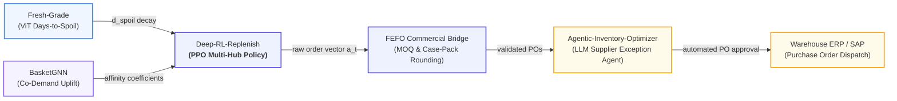

# Deep-RL-Replenish: Mathematical Architecture & System Specification

> **Discipline**: Multi-Hub Inventory Replenishment & Decision Science  
> **Paradigm**: Deep Reinforcement Learning (PPO / DQN) & Stochastic Control  
> **Commercial Context**: Quick-Commerce / Dark Store Grocery Operations (Milkbasket, Zepto, Blinkit)

---

## 1. Executive Summary

Inventory replenishment in rapid-delivery grocery networks is fundamentally an **optimal control problem under deep uncertainty**. A category manager or automated system must place daily replenishment purchase orders (POs) across tens of thousands of SKU $\times$ Dark Store combinations while navigating four aggressively conflicting financial pressures:

1. **Holding Costs ($c_h$)**: Capital tied up in physical shelf space and refrigerated cooling power.
2. **Stockout Penalties ($c_p$)**: Lost revenue, customer churn, and operational service-level SLA breaches.
3. **Fixed Dispatch Costs ($c_o$)**: Truckload dispatch and handling fees per order.
4. **Perishable Spoilage ($c_w$)**: Physical expiry and write-offs of short-shelf-life dairy, produce, and bakery batches.

Classical inventory heuristics such as the **Wilson Economic Order Quantity (EOQ)** or **Base-Stock $(s, S)$** policies assume independent demand, static lead times, and infinite product longevity. In reality, modern quick-commerce exhibits non-stationary demand bursts, multi-day shipping delays (in-transit pipelines), batch spoilage, and cross-SKU affinity. 

**Deep-RL-Replenish** formulates this challenge as a high-dimensional continuous Markov Decision Process (MDP), solved using **Proximal Policy Optimization (PPO)** with a commercial translation bridge (**FEFO Bridge**) enforcing supplier Minimum Order Quantities (MOQ) and case-pack rounding.

---

## 2. Markov Decision Process (MDP) Formalism

The replenishment environment is defined by the 5-tuple $\mathcal{M} = \langle \mathcal{S}, \mathcal{A}, \mathcal{P}, \mathcal{R}, \gamma \rangle$:

### 2.1 State Space $\mathcal{S} \subseteq \mathbb{R}^{H \times S \times (1 + L + 3 + 1)}$
For a network of $H$ dark stores, $S$ SKUs, and supplier lead time $L$ days, the state vector at decision epoch $t$ contains:
$$\mathbf{s}_t = \bigoplus_{h=1}^H \bigoplus_{s=1}^S \mathbf{u}_{t, h, s}$$
where each unit feature vector $\mathbf{u}_{t, h, s} \in \mathbb{R}^{1 + L + 3 + 1}$ decomposes into:
- $I_{t, h, s} \in \mathbb{R}_{\ge 0}$: Current on-hand physical stock.
- $\mathbf{q}_{t, h, s} = [q_{t, 1}, \dots, q_{t, L}] \in \mathbb{R}_{\ge 0}^L$: In-transit orders scheduled to arrive over the next $L$ days.
- $\mathbf{d}_{t, h, s}^{hist} = [d_{t-1}, d_{t-2}, d_{t-3}] \in \mathbb{R}_{\ge 0}^3$: Recent 3-day customer POS demand history.
- $D_{t, h, s}^{spoil} \in \mathbb{R}_{\ge 0}$: Estimated remaining days until batch expiration (injected from *Fresh-Grade* ViT).

### 2.2 Action Space $\mathcal{A} \subseteq [0, a_{max}]^{H \times S}$
At each daily review epoch $t$, the policy outputs a continuous reorder action vector:
$$\mathbf{a}_t = [a_{t, 1, 1}, \dots, a_{t, H, S}]^\top \in [0, a_{max}]^{H \times S}$$
representing the quantity of units ordered from vendors for delivery after $L$ lead-time days.

### 2.3 State Transition Dynamics $\mathcal{P}(s_{t+1} \mid s_t, a_t)$
Between day $t$ and day $t+1$, the physical inventory evolves through four discrete phases:
1. **Shipment Ingestion**:
   $$I_{t, h, s}^{pre} = I_{t, h, s} + q_{t, 1, h, s}$$
   Orders that have completed lead time arrive on dock and become available for picking.
2. **Demand Realization & Fulfillment**:
   Customer demand $D_{t, h, s} \sim \mathcal{N}(\mu_{s}, \sigma_{s}^2)$ is sampled. Fulfilled sales $Y_{t, h, s}$ and lost sales $V_{t, h, s}$ are computed:
   $$Y_{t, h, s} = \min(I_{t, h, s}^{pre}, D_{t, h, s}), \quad V_{t, h, s} = D_{t, h, s} - Y_{t, h, s}$$
   $$I_{t, h, s}^{post} = I_{t, h, s}^{pre} - Y_{t, h, s}$$
3. **Perishable Aging & Spoilage**:
   For perishable SKUs ($s \in \mathcal{P}$), batches are tracked under First-In, First-Out (FIFO) queue dynamics. Unsold stock reaching age $\ge \text{shelf\_life}$ is spoiled and discarded:
   $$W_{t, h, s} = \text{SpoiledUnits}(I_{t, h, s}^{post}), \quad I_{t+1, h, s} = \max(0, I_{t, h, s}^{post} - W_{t, h, s})$$
4. **Pipeline Shift**:
   In-transit queue advances by one day, and new order $a_{t, h, s}$ is queued at position $L$:
   $$q_{t+1, l, h, s} = q_{t, l+1, h, s} \quad \forall l \in [1, L-1], \quad q_{t+1, L, h, s} = a_{t, h, s}$$

### 2.4 Reward Function $\mathcal{R}(s_t, a_t)$
The objective is total commercial cost minimization. The scalar reward is defined as the negative sum of all four cost pressures across the entire network:
$$R_t = - \sum_{h=1}^H \sum_{s=1}^S \Big[ \underbrace{c_h \cdot I_{t+1, h, s}}_{\text{Holding Cost}} + \underbrace{c_p \cdot V_{t, h, s}}_{\text{Stockout Penalty}} + \underbrace{c_o \cdot \mathbb{I}(a_{t, h, s} > 0.5)}_{\text{Fixed Ordering Fee}} + \underbrace{c_w \cdot W_{t, h, s}}_{\text{Perishable Spoilage}} \Big]$$

---

## 3. Policy Optimization via PPO

We optimize a stochastic actor policy $\pi_\theta(a \mid s)$ and state-value baseline $V_\phi(s)$ using Proximal Policy Optimization with Generalized Advantage Estimation (GAE):

### 3.1 Clipped Surrogate Objective
$$\mathcal{L}^{CLIP}(\theta) = \hat{\mathbb{E}}_t \left[ \min\left( r_t(\theta) \hat{A}_t, \; \text{clip}(r_t(\theta), 1-\epsilon, 1+\epsilon) \hat{A}_t \right) \right]$$
where the probability ratio is:
$$r_t(\theta) = \frac{\pi_\theta(a_t \mid s_t)}{\pi_{\theta_{old}}(a_t \mid s_t)}$$

### 3.2 Generalized Advantage Estimation (GAE)
$$\hat{A}_t = \sum_{l=0}^{\infty} (\gamma \lambda)^l \delta_{t+l}^V, \quad \delta_t^V = R_t + \gamma V_\phi(s_{t+1}) - V_\phi(s_t)$$

### 3.3 Full Multi-Task Objective
$$\mathcal{L}(\theta, \phi) = \hat{\mathbb{E}}_t \left[ \mathcal{L}^{CLIP}(\theta) - c_1 \mathcal{L}^{VF}(\phi) + c_2 \mathcal{H}(\pi_\theta(\cdot \mid s_t)) \right]$$
where $\mathcal{L}^{VF}(\phi) = \frac{1}{2} (V_\phi(s_t) - \hat{R}_t)^2$ and $\mathcal{H}$ encourages action entropy to prevent premature policy collapse.

---

## 4. Paradigm Comparison: RL vs. Heuristics vs. LLM Agents

| Metric / Dimension | Classical Heuristic (s, S) | Deep RL (PPO / DQN) | LLM Inventory Agent |
| :--- | :--- | :--- | :--- |
| **Primary Method** | Static closed-form formulas | Deep policy gradient optimization | Reasoning over structured prompt |
| **Lead Time Delay** | Simplified normal convolution | Native multi-stage pipeline state | Approximate heuristic reasoning |
| **Perishable Spoilage** | Unmodeled (assumes infinite life) | Endogenously penalized in reward | Qualitative rules |
| **Decision Latency** | $< 0.1\text{ ms}$ | $< 1.5\text{ ms}$ (GPU tensor op) | $1,500 - 3,500\text{ ms}$ (LLM API) |
| **Throughput (SKUs/sec)** | $> 100,000$ | $> 50,000$ | $5 - 20$ |
| **Non-Linear Dynamics** | Poor (bullwhip amplification) | **Optimal** (stabilizes oscillations) | Moderate |
| **Auditability** | High (math formulas) | Moderate (policy distribution) | High (natural language reasoning) |

> **Strategic Architecture Insight**: In high-scale retail platforms, **Deep RL acts as the high-frequency decision engine** (scoring 50,000 SKUs across 100 dark stores in milliseconds every midnight), while **LLM Agents act as the strategic executive layer** (handling vendor negotiation, contract disputes, weather disruptions, and exception triage).

---

## 5. Autonomous Retail AI Mesh Integration

- **Inbound Stream 1 (Fresh-Grade)**: Real-time visual shelf-life inspection streams estimated days-to-spoil ($D_{spoil}$) into the state vector, dampening replenishment orders on deteriorating batches.
- **Inbound Stream 2 (BasketGNN)**: Co-purchase graph embeddings provide cross-SKU affinity multipliers, anticipating multi-item basket spikes.
- **Outbound Stream 1 (FEFO Commercial Bridge)**: Maps continuous policy actions to supplier minimum order quantities (MOQ) and case-pack multiples.
- **Outbound Stream 2 (Agentic-Inventory-Optimizer)**: Receives validated PO recommendations and executes autonomous vendor EDI communication and negotiation.
